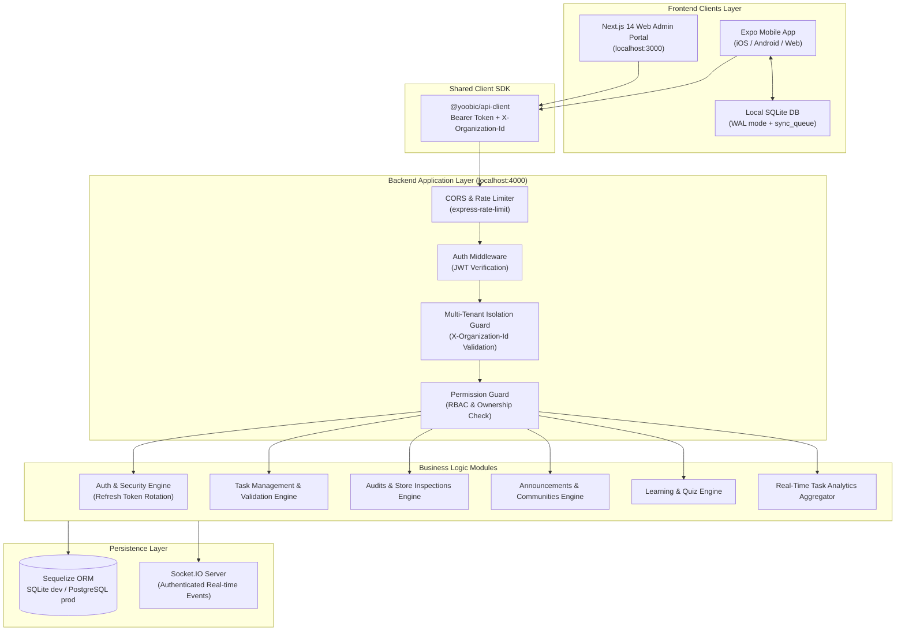
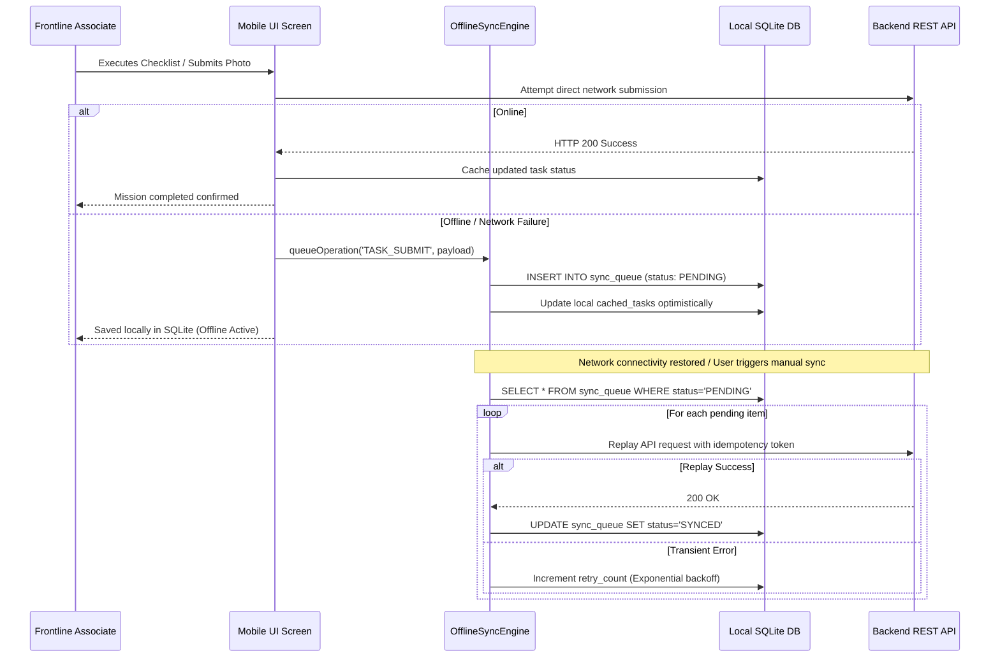

# YOOBIC ONE — Updated Technical Architecture

**Architecture Version:** 2.0  
**Last Updated:** November 2026  
**Status:** Integrated Production Architecture  

---

## 1. System Overview & Monorepo Topology

```
c:\YOOBIC_ONE
├── apps/
│   ├── backend/          # Express, Sequelize ORM, SQLite/PostgreSQL, Socket.IO, JWT Auth
│   ├── admin-web/        # Next.js 14 App Router, TanStack Query, TailwindCSS, Web Admin
│   └── mobile/           # Expo SDK 51, Expo Router, SQLite (WAL mode), Offline Sync Engine
├── packages/
│   ├── shared-types/     # Shared domain contracts, roles, permissions, sync types
│   ├── api-client/       # Typed REST client with automatic token injection & tenant scoping
│   └── validation/       # Zod schemas for input validation
└── docs/                 # Architectural specifications, gap analysis, and test reports
```

---

## 2. High-Level Architecture Diagram



---

## 3. Multi-Tenant Isolation Model

Tenant isolation is strictly enforced at every layer of the application:
1. **Tenant Identification**: Every authenticated request passes the target organization ID via the `X-Organization-Id` HTTP header.
2. **Membership Verification**: The tenant middleware queries the database to guarantee the user holds an active membership within that organization.
3. **Database Query Scoping**: Every query automatically appends `{ where: { organizationId } }`. Cross-tenant queries are blocked with HTTP 403 Forbidden.
4. **Client-Side Cache Purge**: When a user logs out of the mobile client or switches organizations, `offlineSyncEngine.clearOrganizationData(orgId)` purges local SQLite cache tables to ensure complete data sanitization.

---

## 4. Offline-First Synchronization Architecture

The mobile application operates seamlessly in offline and low-connectivity environments (e.g., store basements, remote retail warehouses):



---

## 5. Security & Authentication Architecture

1. **Access Tokens**: Short-lived JSON Web Tokens (JWT) signed with HMAC-SHA256 containing `userId`, `email`, and active `organizationId`.
2. **Refresh Token Rotation**:
   - Refresh tokens are issued with a cryptographically secure UUID `jti` claim.
   - The token hash is computed via SHA-256 (`crypto.createHash('sha256')`) and stored in the database.
   - Upon refresh (`POST /api/v1/auth/refresh`), the old token hash is immediately invalidated and a new pair is issued, preventing token replay attacks.
3. **Password Security**: Bcrypt with a salt factor of 10. Passwords must meet enterprise complexity criteria (minimum 8 characters, uppercase, lowercase, numbers, and symbols).
4. **WebSocket Security**: Socket.IO connection handshake validates the JWT Bearer token before accepting subscriptions to organization-specific rooms (`org_${organizationId}`).
